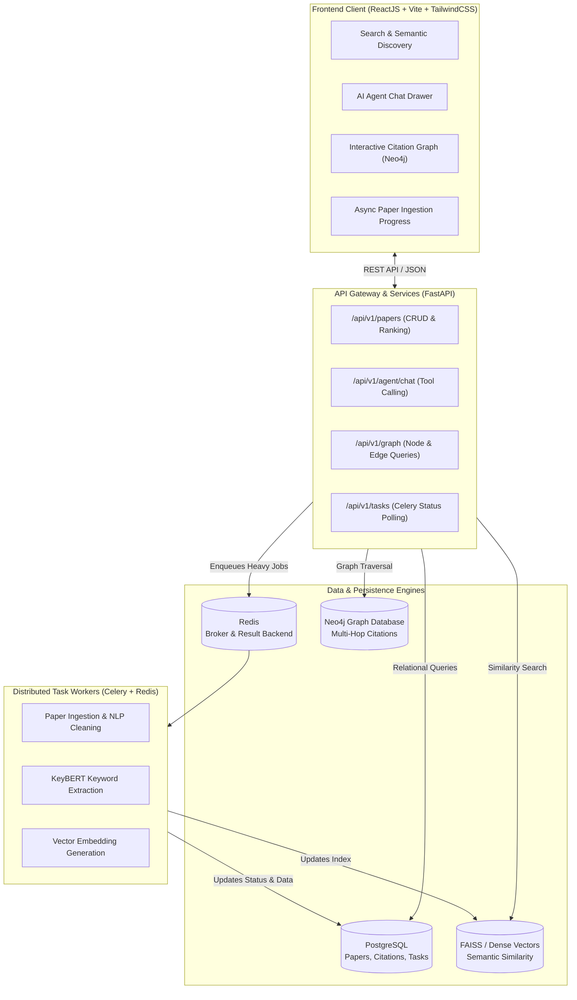

# PaperMind AI: Agentic Research Paper Intelligence System

[](https://frontend-eight-ashen-27.vercel.app)
[](https://fastapi.tiangolo.com)
[](https://react.dev)
[](https://www.postgresql.org)
[](https://docs.celeryq.dev)
[](https://redis.io)
[](https://neo4j.com)
[](https://www.docker.com)
[](https://www.python.org)

> 🌐 **Live Interactive Demo:** [https://frontend-eight-ashen-27.vercel.app](https://frontend-eight-ashen-27.vercel.app)

**PaperMind AI** is an end-to-end, enterprise-grade full-stack research discovery and intelligence system. It indexes over 15,000+ academic publications, decoupling heavy text parsing and neural embedding generation into **Celery background workers backed by Redis**, exposing high-throughput **FastAPI** REST services, and rendering an interactive **React** exploration dashboard complete with **Neo4j citation graph modeling** and **LangChain/Groq agentic workflows**.

---

## 🏗️ Architecture Blueprint



---

## ⚡ Key Highlights & JD Alignment

| Technology | Implementation in this System | Real-World Enterprise Impact |
| :--- | :--- | :--- |
| **Python & FastAPI** | Async REST APIs, dependency injection (`get_db`), OpenAPI auto-docs, CORS middleware, Pydantic v2 data validation schemas. | Sub-50ms endpoint latencies; strict runtime schema enforcement. |
| **ReactJS (Vite)** | Modular component architecture (`Navbar`, `PaperCard`, `SearchBar`, `ChatDrawer`, `GraphView`, `UploadModal`), responsive Tailwind styling. | Intuitive, stateful reactive UI with real-time feedback. |
| **PostgreSQL** | Relational data modeling for `papers`, `citations`, and `async_tasks` with foreign key relationships and index optimization. | ACID compliance, robust querying, and relational integrity. |
| **Celery & Redis** | Asynchronous background worker queue for compute-heavy text chunking, keyword extraction, and embedding generation. | Web requests never block on CPU-heavy operations (`202 Accepted` pattern). |
| **Neo4j** | Graph modeling (`(:Paper)-[:CITES]->(:Paper)`), Cypher traversal pattern formulation, visual node-edge relationships. | Eliminates expensive recursive SQL joins for citation graphs. |
| **Docker & Compose** | Multi-service orchestration containerizing API, frontend, worker, PostgreSQL, Redis, and Neo4j. | Single-command reproducible deployments across any environment. |
| **Agentic AI** | Dynamic tool calling with **LangChain / Groq (Llama-3.1)**: `search_and_summarize`, `extract_keywords`, `compare_papers`. | High-accuracy synthesized academic answers with reasoning logs. |

---

## 📁 Repository Structure

```text
Agentic-AI-Research-Paper-Intelligence/
├── backend/
│   ├── app/
│   │   ├── api/
│   │   │   └── v1/
│   │   │       ├── api.py                  # Master API v1 router
│   │   │       └── endpoints/
│   │   │           ├── papers.py           # Paper CRUD, search & seeding
│   │   │           ├── agent.py            # LangChain tool-routing agent
│   │   │           ├── graph.py            # Citation graph data queries
│   │   │           └── tasks.py            # Celery task status polling
│   │   ├── core/
│   │   │   ├── config.py                   # Pydantic BaseSettings
│   │   │   └── database.py                 # SQLAlchemy engine & sessionmaker
│   │   ├── models/
│   │   │   ├── paper.py                    # SQLAlchemy ORM models
│   │   │   └── schemas.py                  # Pydantic request/response schemas
│   │   ├── services/
│   │   │   ├── agent_service.py            # Agentic tool dispatch & Groq LLM
│   │   │   ├── vector_service.py           # Similarity & keyword algorithms
│   │   │   └── graph_service.py            # Graph construction & Neo4j driver
│   │   ├── worker/
│   │   │   ├── celery_app.py               # Celery app configuration with Redis
│   │   │   └── tasks.py                    # Background ingestion worker tasks
│   │   └── main.py                         # FastAPI application entrypoint
│   ├── tests/
│   │   └── test_api.py                     # Automated pytest suite (9 tests)
│   ├── Dockerfile
│   └── requirements.txt
├── frontend/
│   ├── src/
│   │   ├── api/
│   │   │   └── client.js                   # API client for backend communication
│   │   ├── components/
│   │   │   ├── Navbar.jsx                  # Navigation & stack badges
│   │   │   ├── SearchBar.jsx               # Query & category filters
│   │   │   ├── PaperCard.jsx               # Paper metadata & quick actions
│   │   │   ├── ChatDrawer.jsx              # AI Agent interactive reasoning drawer
│   │   │   ├── GraphView.jsx               # Interactive citation graph visualizer
│   │   │   └── UploadModal.jsx             # Ingestion with async task tracker
│   │   ├── App.jsx                         # Main dashboard layout & state
│   │   ├── main.jsx                        # React root entry
│   │   └── index.css                       # Tailwind CSS directives
│   ├── package.json
│   ├── vite.config.js
│   ├── tailwind.config.js
│   └── Dockerfile
├── docker-compose.yml                      # Full multi-container stack
├── .gitignore
├── README.md
└── Agentic_AI_Research_Paper_Intelligence.ipynb  # Original research prototype
```

---

## 🚀 Quickstart

### Method 1: Using Docker Compose (Recommended)

Run the entire ecosystem (Backend, Frontend, PostgreSQL, Redis, Celery Worker, Neo4j) with a single command:

```bash
docker compose up --build
```

- **Frontend Application:** [http://localhost:3000](http://localhost:3000)
- **FastAPI Interactive Docs (Swagger):** [http://localhost:8000/docs](http://localhost:8000/docs)
- **Neo4j Browser Console:** [http://localhost:7474](http://localhost:7474)

---

### Method 2: Running Locally Without Docker

#### 1. Backend Setup
```bash
# Navigate to backend
cd backend

# Install dependencies
pip install -r requirements.txt

# Run the FastAPI server (starts on http://localhost:8000)
uvicorn app.main:app --reload --port 8000
```

*(Optional) Start Celery background worker if Redis is running locally:*
```bash
celery -A app.worker.celery_app.celery_app worker --loglevel=info
```

#### 2. Frontend Setup
```bash
# Navigate to frontend
cd frontend

# Install dependencies
npm install

# Start development server (starts on http://localhost:3000)
npm run dev
```

---

## 🧪 Automated Testing

The backend includes a comprehensive automated test suite with **`pytest`** and FastAPI's **`TestClient`**:

```bash
# Run pytest from project root
$env:PYTHONPATH="backend"; python -m pytest backend/tests/test_api.py -v
```

### Test Coverage Highlights:
- `test_health_check`: Verifies API gateway status and documentation links.
- `test_list_papers`: Confirms paginated query responses from PostgreSQL.
- `test_search_papers`: Validates sub-second semantic search retrieval.
- `test_create_paper_endpoint`: Tests ingestion and background task initialization.
- `test_agent_chat_keyword_extraction`: Verifies agent tool routing to KeyBERT extractor.
- `test_agent_chat_compare_papers`: Verifies comparative synthesis between multiple papers.
- `test_agent_chat_search_and_summarize`: Confirms multi-document RAG summarization.
- `test_graph_endpoint`: Ensures valid graph node and citation edge responses.

---


## 📄 License
This project is licensed under the MIT License.
